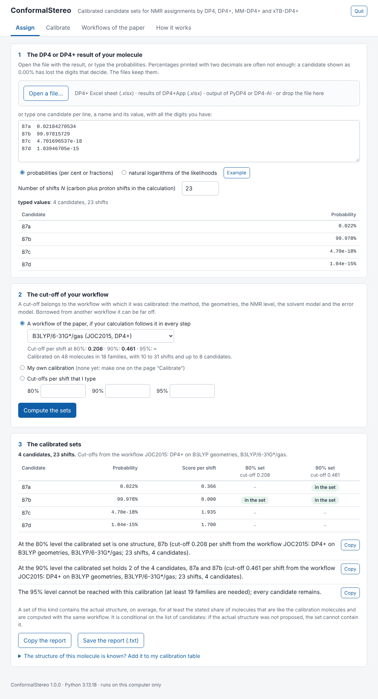

# ConformalStereo

Calibrated candidate sets for NMR stereochemical assignment with DP4, DP4+, MM-DP4+ and xTB-DP4+.

This repository belongs to the paper *How sure is DP4? Calibrated candidate sets for NMR stereochemical assignment*
(A. A. Khairbek et al., manuscript). It holds the data, the analysis and a program for everyday use.

DP4-type methods give each candidate structure a probability. In 3,100 recomputed assignments from five public
benchmarks a call of 99% or more was right in 87% of the cases. The method of the paper keeps the calculation as it is
and replaces the percentage by a set of candidates that contains the actual structure at a chosen rate:

    score of candidate i     s_i = ln(P_best / P_i) / N        N = number of shifts
    calibrated set           every candidate with s_i <= c     c = cut-off of the workflow

The cut-off is calibrated once for a workflow, on molecules of known structure.

## The program

**Windows:** download this repository (green button *Code*, then *Download ZIP*), unpack it, open the folder
`ConformalStereo_App` and double-click `ConformalStereo`. The program opens as a page in your web browser. It uses
the Python that is on the computer; if there is none, it fetches a private copy from python.org into its own folder
(about 11 MB, once). Nothing is installed, and no administrator rights are needed. Windows may ask for confirmation
the first time, because the file came from the internet: choose *More info*, then *Run anyway*.

**macOS and Linux:** `python3 ConformalStereo_App/app/run.py`

What it does:

- **Assign.** Reads the result of your molecule from the DP4+ Excel sheet, from a results file of DP4+App, from an
  output of PyDP4 or DP4-AI, or from typed values, and returns the 80%, 90% and 95% sets with a sentence to quote.
- **Calibrate.** Computes the cut-offs of your own workflow from molecules of known structure.
- **Workflows of the paper.** The cut-offs of the 76 workflows of the five benchmarks.

Everything is computed on your computer; nothing is sent anywhere. Details, the command line and the tests are
described in [`ConformalStereo_App/app/README.md`](ConformalStereo_App/app/README.md).

## What is in the repository

| Folder | Content |
|---|---|
| `ConformalStereo_App/` | the program: one folder, one file to start it |
| `data/` | the pooled table of all 14,437 candidates with their log-likelihoods (3,100 assignments, 152 families, 76 workflows), the 33 compounds with coupling constants, and the SMILES of the structures drawn in the paper |
| `analysis/` | the scripts that produce every table and figure of the paper from the pooled table, with their tables and logs |
| `benchmarks/` | the code that built the pooled table from the public deposits and from the Supporting Information of the source papers, with its logs |

No figure of the paper is stored here; `python analysis/run_all.py --figures` draws them, with the chemical structures
of Figures 1 and 6 and the graphic for the table of contents (these need Matplotlib and RDKit).

## Reproducing the paper

    pip install numpy scipy
    python analysis/run_all.py

This rebuilds all tables in about two minutes and gives the same files on every run. Which file stands behind which
table and figure of the paper is listed in [`analysis/README.md`](analysis/README.md).

## Data sources

| Benchmark | Source | Data |
|---|---|---|
| JOC2015 | Grimblat, Zanardi and Sarotti, *J. Org. Chem.* 2015, 80, 12526, https://doi.org/10.1021/acs.joc.5b02396 | Supporting Information of the paper |
| STX150 | Luciano et al., *J. Chem. Inf. Model.* 2026, 66, 11062, https://doi.org/10.1021/acs.jcim.6c01653 | Supporting Information of the paper |
| DP4-AI | Howarth, Ermanis and Goodman, *Chem. Sci.* 2020, 11, 4351, https://doi.org/10.1039/D0SC00442A | https://doi.org/10.17863/CAM.47721 (CC BY 4.0) |
| Cam2017 | Ermanis, Parkes, Agback and Goodman, *Org. Biomol. Chem.* 2017, 15, 8998, https://doi.org/10.1039/C7OB01379E | https://doi.org/10.17863/CAM.13222 (CC BY 4.0) |
| Cam2019 | Ermanis, Parkes, Agback and Goodman, *Org. Biomol. Chem.* 2019, 17, 5886, https://doi.org/10.1039/C9OB00840C | https://doi.org/10.17863/CAM.32463 (CC BY 4.0) |

The pooled table holds log-likelihoods that were computed again for this work; see [`data/README.md`](data/README.md).

## Licence and citation

The code is under the MIT licence (`LICENSE`). The tables in `data/` and `analysis/tables/` may be used under
CC BY 4.0; please cite the paper and the sources of the benchmarks. Parts of `benchmarks/` follow the logic of PyDP4
and use parameters of DP4+App, both under the MIT licence; their notices are kept in that folder.

If you use the method or the program, please cite the paper (see `CITATION.cff`).
